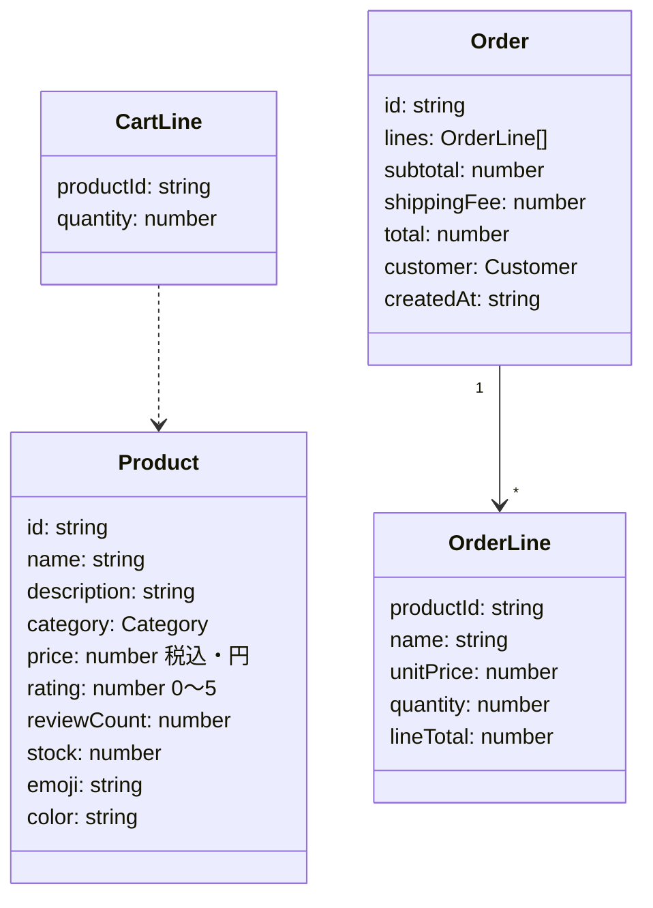

# 機能設計: ビジネスルール（ユニット ec-app）

## 1. ドメインモデル

## 2. 価格計算ルール（`shared/pricing.ts`）

| ID | ルール |
| --- | --- |
| BR-P1 | 価格はすべて**税込の整数（円）**で扱う |
| BR-P2 | 小計 = Σ（単価 × 数量） |
| BR-P3 | 小計が **5,000 円以上なら送料 0 円**、未満なら **500 円**。ただし小計 0 円（カートが空）の場合は送料 0 円 |
| BR-P4 | 合計 = 小計 + 送料 |
| BR-P5 | 送料無料までの残額 = max(0, 5,000 − 小計) |
| BR-P6 | 表示は `¥1,234` 形式（`Intl.NumberFormat('ja-JP', { style: 'currency', currency: 'JPY' })`） |

## 3. カートルール（`CartContext`）

| ID | ルール |
| --- | --- |
| BR-C1 | 同一商品を追加した場合は明細を増やさず数量を加算する |
| BR-C2 | 数量は 1 以上、在庫数以下に丸める。在庫 0 の商品は追加できない |
| BR-C3 | 1 明細あたりの数量上限は 99 |
| BR-C4 | カートは `localStorage` のキー `hibi-market:cart:v1` に保存する。不正な値は無視して空カートとする |
| BR-C5 | 商品マスタから消えた商品はカート表示時に除外する |

## 4. 入力検証ルール（`shared/validation.ts`）

| 項目 | 必須 | ルール | エラーメッセージ例 |
| --- | --- | --- | --- |
| 氏名 `name` | ○ | 前後空白除去後 1〜50 文字 | 「お名前を入力してください」 |
| メール `email` | ○ | `xxx@yyy.zz` 形式 | 「メールアドレスの形式が正しくありません」 |
| 郵便番号 `postalCode` | ○ | `123-4567` または `1234567` | 「郵便番号は 7 桁の数字で入力してください（例: 123-4567）」 |
| 住所 `address` | ○ | 前後空白除去後 1〜200 文字 | 「ご住所を入力してください」 |
| 電話番号 `phone` | ○ | ハイフンを除いて 10〜11 桁の数字 | 「電話番号は 10〜11 桁の数字で入力してください」 |
| 支払方法 `paymentMethod` | ○ | `card` / `cod` のいずれか | 「お支払い方法を選択してください」 |

- 全角数字・全角ハイフンは半角に正規化してから検証する（入力ミスを減らす UX 配慮）
- 同じ検証関数をフロントエンド（即時フィードバック）とサーバー（最終判定）で使用する

## 5. 注文確定ルール（`server/store.ts`）

| ID | ルール |
| --- | --- |
| BR-O1 | 明細が 0 件の注文は `400` |
| BR-O2 | 数量は 1〜99 の整数でなければ `400` |
| BR-O3 | 存在しない商品を含む場合は `400` |
| BR-O4 | 同一商品が複数明細にある場合は数量を合算して判定する |
| BR-O5 | いずれかの明細で在庫が不足する場合は `409`（「○○の在庫が不足しています（残り N 点）」）とし、**どの在庫も減らさない** |
| BR-O6 | すべての検証を通過した後に在庫をまとめて減算し、注文を保存する |
| BR-O7 | 注文番号は `HM-YYYYMMDD-XXXXXX`（XXXXXX は英大文字と数字のランダム 6 文字） |
| BR-O8 | 単価・合計はサーバーの商品マスタから計算し、クライアントの値は使わない |
