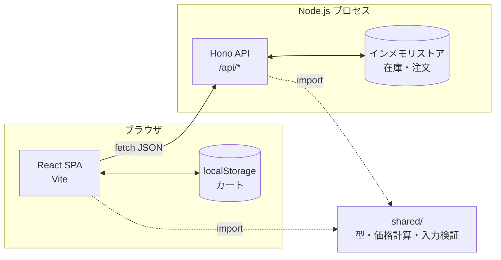
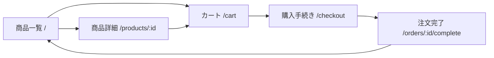

# アプリケーション設計

## 1. 全体構成



- **開発時**: Vite 開発サーバー（:5173）が `/api` を Hono（:8787）へプロキシする
- **ローカル本番相当**: `npm run build` 後、Hono が API と静的ファイル（`dist/`）を 1 プロセスで配信する（:8787）
- 価格計算と入力検証のロジックは `shared/` に置き、**フロントエンドとサーバーで同一コードを使う**ことで表示と確定値のずれを防ぐ

## 2. コンポーネント

### 2.1 共有モジュール（`shared/`）

| モジュール | 責務 |
| --- | --- |
| `types.ts` | `Product` / `CartLine` / `CheckoutForm` / `Order` などの型 |
| `pricing.ts` | 小計・送料・合計の計算、送料無料までの残額、円表記フォーマット |
| `validation.ts` | 購入手続きフォームの項目別検証 |
| `catalog.ts` | 商品の絞り込み・並べ替え（純粋関数） |

### 2.2 サーバー（`server/`）

| モジュール | 責務 |
| --- | --- |
| `products.ts` | 初期商品データ（12 点） |
| `store.ts` | 在庫・注文のインメモリ管理、注文作成時の在庫引当（全明細の検証後にまとめて引当） |
| `app.ts` | Hono のルーティングとリクエスト検証 |
| `index.ts` | HTTP サーバーの起動、ビルド済み静的ファイルの配信 |

### 2.3 フロントエンド（`src/`）

| 区分 | コンポーネント | 責務 |
| --- | --- | --- |
| 状態 | `CartContext` | カート状態の管理と localStorage への永続化 |
| 状態 | `ToastContext` | トースト通知の表示 |
| 状態 | `useProducts` | 商品データの取得とキャッシュ |
| ページ | `ProductListPage` | 検索・カテゴリ・並べ替え・一覧（US-01〜03） |
| ページ | `ProductDetailPage` | 商品詳細（US-04, US-05） |
| ページ | `CartPage` | カート編集・合計（US-06, US-07） |
| ページ | `CheckoutPage` | 配送先・支払方法の入力、注文確定（US-08, US-09） |
| ページ | `OrderCompletePage` | 注文完了 |
| 部品 | `Header` / `ProductCard` / `QuantityStepper` / `ShippingProgress` / `OrderSummary` / `Skeleton` | 共通 UI |

## 3. API 設計

| メソッド | パス | 説明 | 主なレスポンス |
| --- | --- | --- | --- |
| GET | `/api/products` | 全商品（在庫数込み） | `200 { items: Product[] }` |
| GET | `/api/products/:id` | 商品詳細 | `200 Product` / `404` |
| POST | `/api/orders` | 注文作成 | `201 Order` / `400 { error, fieldErrors? }` / `409 { error }` |

### POST `/api/orders` リクエスト

```json
{
  "items": [{ "productId": "p-01", "quantity": 2 }],
  "customer": {
    "name": "山田 太郎",
    "email": "taro@example.com",
    "postalCode": "100-0001",
    "address": "東京都千代田区千代田1-1",
    "phone": "09012345678",
    "paymentMethod": "card"
  }
}
```

クライアントから価格は送らない。サーバーが商品マスタの価格で合計を計算する。

## 4. 画面遷移


