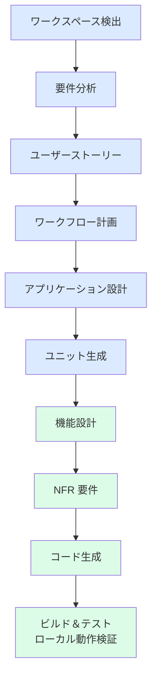

# ワークフロー計画

## 実行するステージ

## ステージごとの判断

| ステージ | 実行 | 理由 |
| --- | --- | --- |
| ワークスペース検出 | ✅ | 空のリポジトリを確認し、Greenfield と判定 |
| リバースエンジニアリング | ⏭ | `--skip` 指定（既存コードもなし） |
| プラクティス探索 | ⏭ | `--skip` 指定 |
| 要件分析 | ✅ | 「シンプル」「優れた UX」の解釈を明文化するため |
| ユーザーストーリー | ✅ | UX 重視のため、ペルソナと受け入れ基準を定義 |
| アプリケーション設計 | ✅ | フロントエンドと API の責務分担を定義 |
| ユニット生成 | ✅ | 単一ユニット `ec-app` に集約（規模が小さいため） |
| リファインドモックアップ | ⏭ | `--skip` 指定 |
| 機能設計 | ✅ | 価格計算・在庫引当・入力検証のルールを定義 |
| NFR 要件 | ✅ | UX・アクセシビリティ要件を検証可能な形で定義 |
| NFR 設計／インフラ設計／コントラクト設計 | ⏭ | `--skip` 指定 |
| コード生成 | ✅ | |
| ビルド＆テスト | ✅ | ローカルでのビルド・ユニットテスト・E2E テストまで |
| Operations 全般 | ⏭ | `--skip` 指定、およびクラウドデプロイ対象外の指示 |

## リスク評価

| リスク | 影響 | 対策 |
| --- | --- | --- |
| 要件の前提（会員登録なし等）がユーザーの意図と異なる | 中 | 要件定義書に前提を明記し、変更しやすい構成にする |
| データがサーバー再起動で消える | 低 | ローカル検証用途として許容し、README に明記 |
| 価格改ざん | 中 | 合計はサーバー側で再計算する |
