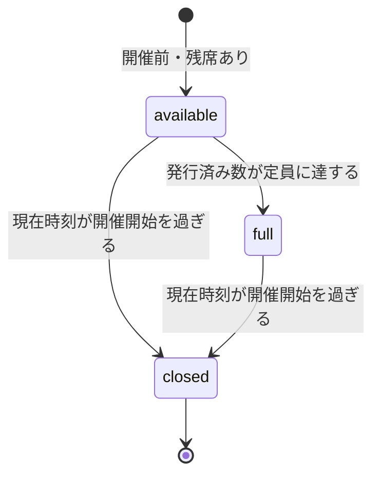
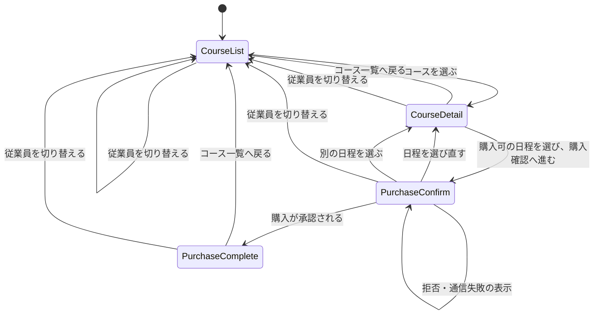
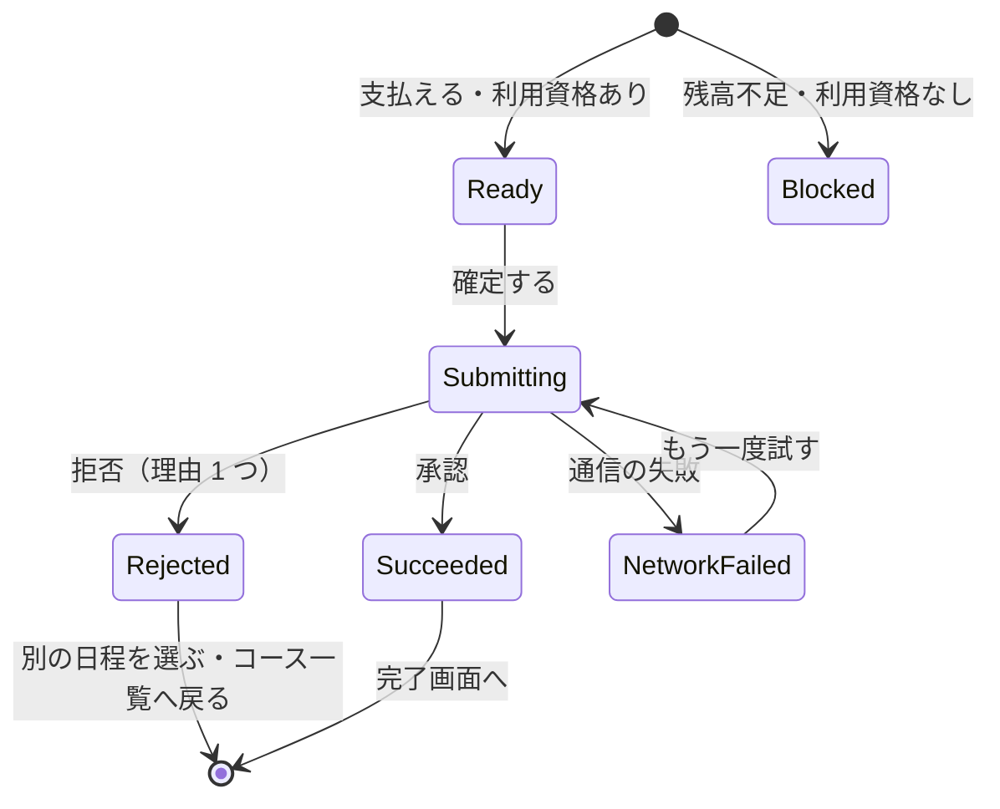
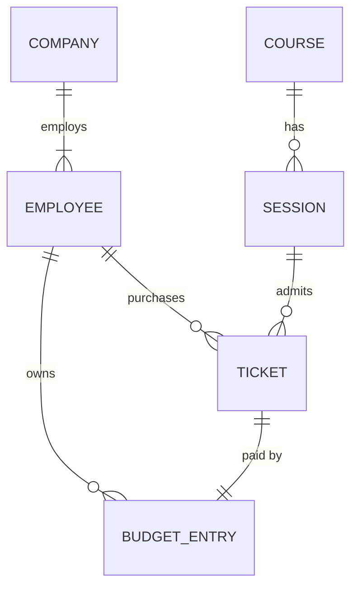

# 機能仕様（U1 購入の最小の流れ）

U1（`u1-purchase-skeleton`）の振る舞いを定める。この文書は、**利用の流れ（手順）と状態の遷移の正本**である。データの形は `entities.md`、判断のルールは `rules.md` が正本で、この文書の ER 図とルールの要約はそこから作った派生の表示である。

## 1. 範囲

| 含めるもの | 含めないもの（担当ユニット） |
| --- | --- |
| 探索条件なしのコース一覧（既定の並び、件数、読み込み中・失敗の表示） | キーワード・カテゴリ・空席ありのみ・期間の絞り込み、並べ替えの選択、URL への条件の反映、0 件と「条件をリセット」（U2） |
| コースの詳細と日程の選択（満席・受付終了・購入済みの表示） | 購入済みチケットの一覧、完了画面とヘッダーからその一覧への導線（U3） |
| 購入確認・購入・完了と e チケットの表示・チケット 1 枚の詳細の受け口 | |
| 操作中の従業員の表示と切り替え、契約外企業の案内 | |
| monorepo の土台、2 プロセスでの起動、初期データ | |

担当ストーリー: US1.1、US2.1〜US2.3、US3.1〜US3.5、US4.1、US5.1（`../../../inception/units-generation/unit-of-work-story-map.md`）。

U1 の一覧が探索条件なしでも 0 件になることはない（初期データに 12 コース以上ある）が、読み込み失敗の最小限の表示（失敗の文言と「再試行」）は U1 で用意する（ストーリーとユニットの対応表の US1.9 の備考）。0 件の表示と「条件をリセット」は U2 で加える。

## 2. 業務の部品と関数の形

六角形アーキテクチャ（ADR-001）に沿い、業務の部品は純粋関数だけを持ち、データの読み書きは「関数の形」として定める。アダプター（InMemoryStore・WebApi・WebUi）がその形の関数を実装し、起動時に WebApi が部分適用して組み立てる。

| 部品 | U1 で持つ純粋関数（入力 → 出力） | 外から受け取る関数 |
| --- | --- | --- |
| CourseCatalog | コース一覧の集計（コース・日程・現在時刻 → 一覧の行）、コースの詳細（コース ID → コースと日程、または「見つからない」）、日程の状態の判定（日程・発行済み数・現在時刻 → 購入可／満席／受付終了） | 日程 ID → 発行済み数（ADR-005） |
| Eligibility | 利用資格の判定（従業員 ID → eligible／company-not-active／employee-not-found）、切り替え用の従業員一覧 | 従業員と企業の取得 |
| TrainingBudget | 残高の計算（取引の一覧 → 残高）、支払い可否・不足額・購入後の残高（残高・受講料 → 結果）、消費取引の生成 | 従業員の取引の取得 |
| Purchasing | 購入の決定（PurchaseSnapshot → PurchaseDecision）、日程ごとの発行済み数、チケット 1 枚の詳細の組み立て | チケットの取得、チケット番号の候補を作る関数（乱数。BR5.6） |
| InMemoryStore | 状態（全データ） → 新しい状態 を返す更新を 1 か所で直列に適用する、購入の記録（最新の状態で決定をやり直して反映。BR5.4）、初期データの生成 | 現在時刻を返す関数 |

決定関数を純粋に保つため、**現在時刻と乱数は引数（関数）として渡す**。テストでは固定の時刻・固定の乱数を渡して結果を確かめる。

## 3. Web API の受け口（U1）

画面と Web API は別のプロセス（別のオリジン）で動く。資格情報（Cookie）付きの通信は画面のオリジンだけに許可する（BR6.3）。応答は JSON で、日時はタイムゾーン付き、ポイントは整数で返す。

| 操作 | 方法とパス（例） | 入力 | 成功時の応答 | 失敗時 |
| --- | --- | --- | --- | --- |
| コース一覧 | `GET /api/courses` | なし（U2 で探索条件を追加できる形にする） | コースの行の一覧（コース ID・コース名・カテゴリ・概要・受講料・直近の開催日・空席のある日程の数）、件数 | 5xx |
| コースの詳細 | `GET /api/courses/{courseId}` | コース ID、Cookie | コースの全項目と日程の一覧（日程 ID・開催日時・会場または形式・定員・残席数・表示用の状態） | ID の形式不正は 400、存在しなければ 404（BR7.9） |
| 操作中の従業員 | `GET /api/me` | Cookie（なければ BR6.2） | 従業員 ID・表示名・企業名・契約状態・利用資格・残高 | — |
| 切り替え用の従業員一覧 | `GET /api/employees` | なし | 従業員 ID・表示名・企業名・契約状態の一覧 | — |
| 従業員の切り替え | `POST /api/session/employee` | 切り替え先の従業員 ID、CSRF 対策の専用ヘッダー | Cookie を発行し、操作中の従業員（`GET /api/me` と同じ形）を返す | 一覧にない ID は 404、CSRF 条件を満たさなければ 403（BR6.1、BR6.3） |
| 購入 | `POST /api/purchases` | 日程 ID、Cookie、CSRF 対策の専用ヘッダー（金額は受け取らない。BR5.2） | 発行した e チケット（BR5.9 の項目）と購入後の残高 | 拒否は 409 と拒否の理由 1 つ（BR5.1）。形式不正は 400、CSRF 条件を満たさなければ 403 |
| チケット 1 枚の詳細 | `GET /api/tickets/{ticketId}` | チケット ID、Cookie | e チケット（BR5.9 の項目） | 本人のものでなければ 404（BR5.10） |

すべての要求で、メソッド・パス・状態コード・処理時間をログに出す。購入の拒否は理由もログに出す（BR5.8、NFR10）。

## 4. 利用の流れ（手順）

### WF1. サイトを開いてコース一覧を見る（US1.1、US3.1、US5.1）

1. 画面は起動時に、操作中の従業員（`GET /api/me`）とコース一覧（`GET /api/courses`）を並行して取得する。取得中はそれぞれ読み込み中の表示にする（BR7.1）。
2. Web API は Cookie がなければ先頭の従業員（高橋 遥）の Cookie を発行し、その従業員を返す（BR6.2）。ログイン画面は出さない。
3. ヘッダーに従業員名・企業名・残高を表示する（BR7.11、BR7.10）。
4. 一覧はコースごとにコース名・カテゴリ・概要・受講料・直近の開催日・空席のある日程の数を、既定の並び（BR3.3）で表示し、件数を表示する（BR3.4）。
5. 操作中の従業員の利用資格が company-not-active なら、一覧の上部に利用できない旨の案内を出す（BR1.3）。閲覧は続けられる（BR1.2）。
6. 一覧の取得に失敗したら、失敗の表示と「再試行」を出す。「再試行」で手順 1 の一覧の取得をやり直す（BR7.1）。

### WF2. コースの詳細を見て日程を選ぶ（US2.1〜US2.3）

1. 一覧でコースを選ぶと、コースの詳細へ移動し、`GET /api/courses/{courseId}` を取得する。
2. 存在しないコースなら「コースが見つかりません」と「コース一覧へ戻る」を表示して終わる（BR7.9）。
3. コース名・カテゴリ・概要・説明・受講料・所要時間・形式と、日程の一覧を表示する。日程ごとに開催日時（日本時間）・会場または形式・定員・残席数・表示用の状態を出す（BR2.1〜BR2.4、BR7.10）。
4. 選べない日程（受付終了・満席・購入済み）は理由を文字で示し、選択できない（BR2.5）。
5. 日程を選ぶ前は「購入確認へ進む」を無効にし、日程を選ぶよう案内する。購入可の日程を選ぶと、選んだ日程が分かる表示にして「購入確認へ進む」を有効にする（BR7.2）。
6. 利用資格が company-not-active なら、詳細の上部にも利用できない旨の案内を出す（BR1.3）。

### WF3. 購入確認から購入を確定する（US3.2〜US3.5、US4.1）

1. 「購入確認へ進む」で購入確認へ移動する。コース名・開催日時・会場または形式・受講料・現在の残高を表示する（FR5.1）。
2. 支払えるなら購入後の残高を表示し（BR4.4）、支払えないなら不足額を表示して確定ボタンを無効にする（BR4.2、BR4.3）。利用資格がなければ確定ボタンを無効にし、案内を出す（BR1.4）。
3. 「日程を選び直す」はコースの詳細へ戻る。何も購入しない（BR7.8）。
4. 確定ボタンを押すと、確定ボタンを無効にして「購入を処理しています」と表示し、`POST /api/purchases` を 1 回だけ送る（BR7.3）。
5. Web API は Cookie の従業員 ID と日程 ID から購入の記録を依頼する。データストアは直列の更新の中で最新の状態から写しを作り、決定関数を評価する（BR5.4）。
6. 決定関数は BR5.1 の順に調べる。当てはまる理由があれば拒否の理由 1 つを返し、何も反映しない。なければチケット 1 枚（番号は BR5.6、支払いは BR5.2、日時は BR5.7）と消費の取引 1 件（BR4.5）を作る。
7. 承認ならデータストアはチケットと消費の取引を同時に反映する（BR5.3）。Web API は e チケットと購入後の残高を返す。
8. 画面は完了画面へ移動して e チケットを表示し（BR5.9）、ヘッダーの残高を購入後の値に更新する（BR7.7）。完了画面の「コース一覧へ戻る」でコース一覧へ移動する。
9. 拒否なら、理由ごとのメッセージと次の操作を表示する（BR7.4）。「別の日程を選ぶ」はコースの詳細を読み込み直す（BR7.5）。残高は変わらない。
10. 応答が得られなかった（通信の失敗）なら、「通信に失敗しました」「もう一度試す」と、購入できたかの確かめ方（コースの詳細の「購入済み」表示）を案内する（BR7.6）。

### WF4. 従業員を切り替える（FR1.2、US3.1）

1. ヘッダーの切り替えの部品を開くと、切り替え用の従業員一覧（`GET /api/employees`）から従業員名・企業名・契約状態を表示する。
2. 従業員を選ぶと `POST /api/session/employee` を送る。Web API は従業員が一覧にいることを確かめ、Cookie を発行する（BR6.1、BR6.3）。
3. 成功したら、どの画面にいても、選んでいた日程・購入確認・購入の結果・表示中のチケットを捨ててコース一覧へ移動し、操作中の従業員とコース一覧を読み込み直す（BR6.4）。
4. 失敗したら、切り替えに失敗したことをヘッダーの近くに表示し、操作中の従業員は変えない。

### WF5. 完了画面を開き直す（US4.1）

1. 完了画面はチケット ID を含む URL を持つ。再読み込みしたときは `GET /api/tickets/{ticketId}` で e チケットを取得して表示する。
2. 本人のチケットでなければ（404）「チケットが見つかりません」と「コース一覧へ戻る」を表示する（BR5.10）。

### WF6. 同時に購入が届いたとき（US3.3 の AC3.3.4）

1. 残席 1 の日程に、2 人の購入の要求がほぼ同時に届く。
2. データストアは 2 件を順に 1 件ずつ適用する（BR5.4）。
3. 1 件目は最新の状態で承認され、チケットが発行されて残席は 0 になる。
4. 2 件目は、1 件目を反映した後の最新の状態で決定をやり直すため、満席（full）で拒否される。予算も残席も変わらない。

## 5. 状態の遷移

### 5.1 日程の状態（計算で求める。保存しない）

テキストでの説明: 日程は「購入可（available）」から、チケットの発行で残席が 0 になると「満席（full）」になる。開催開始の時刻を過ぎると、購入可・満席のどちらからも「受付終了（closed）」になる。U1 では購入の取り消しがないため、満席から購入可へは戻らない（要件 A4）。操作中の従業員が購入済みなら、表示ではこの状態より「購入済み」を優先する（BR2.4）。

### 5.2 画面の遷移

テキストでの説明: 主要な流れは「コース一覧 → コースの詳細（日程の選択）→ 購入確認 → 完了」で、ページの遷移は 3 回（NFR4）。いずれも全画面を読み込み直さない画面内の移動とする。従業員を切り替えると、どの画面からもコース一覧へ戻る（BR6.4）。

### 5.3 購入確認の中の状態

テキストでの説明: 支払えて利用資格があれば確定できる（Ready）。残高不足や利用資格がなければ確定ボタンは無効（Blocked）。確定中（Submitting）はボタンを無効にする（BR7.3）。結果は承認・拒否・通信の失敗のいずれかで、通信の失敗からは「もう一度試す」で再送できる（BR7.6）。

## 6. 初期データ（U1 で用意するもの）

起動するたびに、起動した日を基準にした日時で生成する（FR7.3）。U2 の探索の確認にもそのまま使えるよう、FR7.2 の種類をそろえる。

| 種類 | 中身 |
| --- | --- |
| 企業 | 契約中 2 社（株式会社サンプル商事ほか）、契約終了 1 社 |
| 従業員 | 先頭は高橋 遥（サンプル商事、付与 60,000 pt）。ほかに、残高ちょうど 25,000 pt の従業員、残高 20,000 pt の従業員（残高不足の確認用）、契約終了企業の従業員を含む。合計 4 名以上 |
| 予算の付与 | 従業員ごとに付与の取引を 1 件以上（残高は付与の合計から計算する） |
| コース | 4 カテゴリ以上・12 コース以上。受講料が 25,000 pt のコースを含む。オンラインと会場の両方を含む |
| 日程 | 未来の日程（起動日の数日後〜数か月後）を中心に、満席の日程（定員と同数のチケットを初期データで発行済み）、受付終了の確認用の過去の日程、残席 1 と残席 3 の日程、今後の日程がないコースを含む |
| チケット | 満席の日程を作るために、初期データとして発行済みのチケット（と対応する消費の取引）を含めてよい。その場合も BR5.3〜BR5.6 を満たす |

## 7. エラーと境目の扱い

| 場面 | 振る舞い | ルール |
| --- | --- | --- |
| ID の形式が不正（例: コース ID が C と 3 桁の数字でない） | 400 と理由を返す | NFR3 |
| 存在しないコース・日程・チケット | コース・チケットは 404。購入では session-not-found の拒否 | BR7.9、BR5.1、BR5.10 |
| Cookie の従業員 ID が存在しない | 閲覧には応え、購入は employee-not-found で拒否 | BR6.2、BR1.1 |
| 残高ちょうど受講料 | 購入でき、購入後の残高は 0 | BR4.2 |
| 開催開始の時刻ちょうど | 受付終了（現在時刻 ≥ startsAt） | BR2.2 |
| 確定ボタンの連打 | 要求は 1 回。届いても 2 回目は already-purchased | BR7.3、BR5.5 |
| 要求に金額を含めて改ざん | 金額を読まず、コースの受講料で差し引く | BR5.2 |
| CSRF 対策の条件を満たさない書き込み | 403、何も変えない | BR6.3 |
| チケット番号の衝突 | 作り直す | BR5.6 |
| Web API の予期しない失敗 | 5xx と一般的なメッセージを返し、内部の情報は出さない。状態は変えない | NFR3、NFR10 |

## 8. エンティティの関係（`entities.md` から作った図）

テキストでの説明: コースは 0 件以上の日程を持つ。企業には 1 人以上の従業員が所属する。従業員は予算の取引とチケットを 0 件以上持つ。日程には 0〜定員枚のチケットが発行される。チケット 1 枚には消費の取引がちょうど 1 件対応する（付与の取引はチケットを指さない）。

## 9. ルールの要約（`rules.md` から作った表）

| グループ | ルール | 主な中身 |
| --- | --- | --- |
| 利用資格 | BR1.1〜BR1.4 | 契約中だけ購入可、閲覧は可、契約外の案内、確定の無効化 |
| 日程の状態 | BR2.1〜BR2.5 | 残席の計算、受付終了、判定の順、購入済みの優先、選べない理由の文字表示 |
| 一覧の集計と並び | BR3.1〜BR3.4 | 直近の開催日（満席も含む）、空席のある日程の数、既定の並び、件数 |
| 研修予算 | BR4.1〜BR4.5 | 残高の計算、支払い可否、不足額、購入後の残高、消費取引 |
| 購入とチケット | BR5.1〜BR5.10 | 最終チェックの順と理由 1 つ、金額の決め方、同時記録、直列化、1 人 1 枚、番号、日時、ログ、表示項目、本人だけ |
| 操作中の従業員 | BR6.1〜BR6.4 | Cookie、初期の従業員と保持、CSRF 対策、切り替えで一覧へ戻す |
| 画面の表示と操作 | BR7.1〜BR7.11 | 読み込みの区別、進む操作の有効化、処理中、拒否の表示、読み直し、通信失敗、残高の更新、戻る、見つからない、日時とポイント、ヘッダー |

## 10. 参照した資料

- 要件定義書: `../../../inception/requirements-analysis/requirements.md`
- ユニット定義: `../../../inception/units-generation/unit-of-work.md`
- ストーリーとユニットの対応: `../../../inception/units-generation/unit-of-work-story-map.md`
- コンポーネント設計と ADR: `../../../inception/domain-design/components.md`、`../../../inception/domain-design/decisions.md`
- ユーザーストーリー: `../../../inception/user-stories/stories.md`
- 機能設計の確認事項: `functional-design-questions.md`
