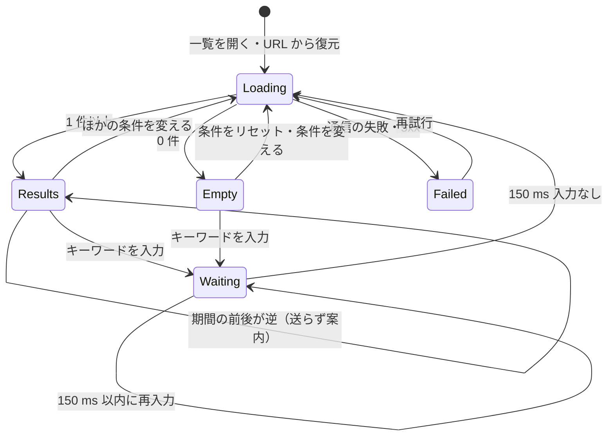
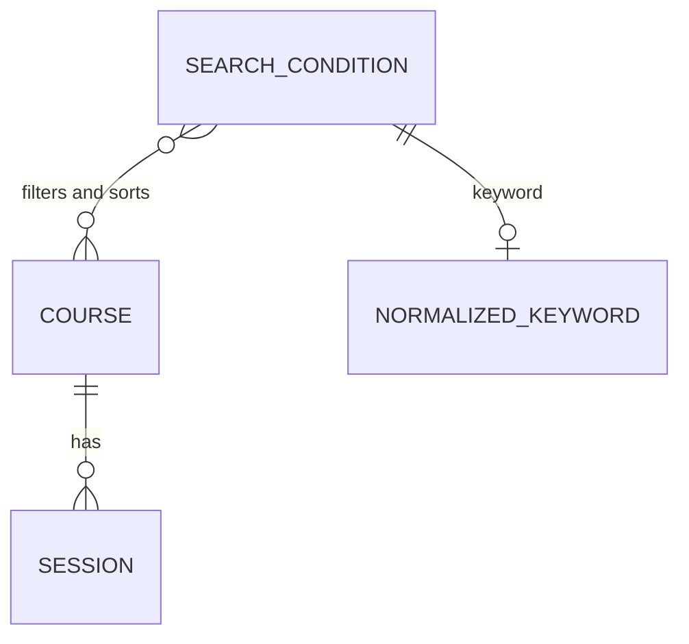

# 機能仕様（U2 コース探索）

U2（`u2-course-search`）の振る舞いを定める。この文書は**利用の流れ（手順）と状態の遷移の正本**である。データの形は `entities.md`、判断のルールは `rules.md` が正本で、この文書の ER 図とルールの要約はそこから作った派生の表示である。

## 1. 範囲

| 含めるもの | 含めないもの |
| --- | --- |
| U1 のコース一覧に、キーワード・カテゴリ・空席ありのみ・期間の絞り込み、4 つの並べ替え、件数、URL への反映と復元、0 件と「条件をリセット」、読み込み失敗と「再試行」を加える | 購入済みチケットの一覧と導線（U3） |
| コースによみがなを足す（初期データを含む） | コースの詳細・購入の流れの変更（U1 のまま） |
| 詳細から一覧へ戻ったときの条件の保持（AC1.8.4） | |

担当ストーリー: US1.2〜US1.9（`../../../inception/units-generation/unit-of-work-story-map.md`）。US1.6 の既定の並びは U1 で実装済みで、U2 は並べ替えを選ぶ操作を加える。

U1 が用意した共有部分（コース一覧の画面と受け口）に「足す」だけで、U1 の振る舞い（既定の並び・一覧の項目・購入の流れ）は変えない。

## 2. 業務の部品と関数の形

| 部品 | U2 で足す純粋関数（入力 → 出力） | 外から受け取る関数 |
| --- | --- | --- |
| CourseCatalog | 探索条件の検証（生の条件 → SearchCondition か SearchConditionError の並び）、キーワードの正規化（文字列 → NormalizedKeyword）、絞り込み（コース・日程・条件・現在時刻 → コースの並び）、並べ替え（コースの並び・並べ方 → コースの並び） | 日程 ID → 発行済み数（U1 と同じ。ADR-005） |
| InMemoryStore | 初期データのコースによみがなを足す | — |
| WebApi | コース一覧の受け口で探索条件を受け取り、検証・絞り込み・並べ替えを呼ぶ | — |
| WebUi | 探索条件の状態・入力・URL との相互の変換・送るタイミング・古い応答の破棄 | — |

画面（WebUi）は絞り込みと並べ替えのロジックを持たない（ADR-006）。画面が持つのは、送る前の形の確認（BR11.5）と URL の扱いだけである。

## 3. Web API の受け口（U2 で変えるもの）

| 操作 | 方法とパス（例） | 入力（クエリ） | 成功時の応答 | 失敗時 |
| --- | --- | --- | --- | --- |
| コース一覧（探索） | `GET /api/courses` | `q`・`category`・`available`（`true`/`false`）・`from`・`to`（`YYYY-MM-DD`）・`sort`（`date`/`fee-asc`/`fee-desc`/`name`）。どれも省略できる | U1 と同じコースの行の一覧と件数。条件なしは U1 と同じ結果 | 形の決まった条件が不正なら 400 と `{ error: { code: "invalid-search-condition", fields: [{ field, reason }] } }`（BR8.6）。キーワードでは 400 にしない |

条件なしの要求（U1 の画面と同じ）の応答は、U1 から変えない。

## 4. 利用の流れ（手順）

### WF1. キーワードで探す（US1.2）

1. 利用者がキーワード欄に入力する。
2. 画面は、最後の入力から 150 ms 入力がなければ探索を送る（BR11.1）。待っている間に入力があれば待ち直す。
3. 送るたびに要求の番号を進め、件数表示と一覧の部分だけを読み込み中にする（全画面は読み込み直さない）。
4. Web API はキーワードを正規化して（BR8.1）、コース名か概要にすべての語を含むコースだけに絞り込み（BR9.1）、並べ替えて（BR10）、件数とともに返す。
5. 画面は、応答の番号が最後に送った番号と同じときだけ一覧と件数を更新する（BR11.2）。
6. URL のクエリの `q` を書き換える（BR11.3）。
7. キーワードを空にすると、キーワードの条件なしで探索し直す（AC1.2.5）。

### WF2. カテゴリ・空席ありのみ・並べ替えを変える（US1.3、US1.4、US1.6、US1.7）

1. 利用者が選択肢を変える（BR11.10）。
2. 画面はすぐに探索を送る（BR11.1）。以降は WF1 の 3〜6 と同じ。
3. カテゴリで「すべて」を選ぶと、カテゴリの条件を外す（AC1.3.2）。空席ありのみを外すと、満席のコースも含めて表示する（AC1.4.3）。

### WF3. 期間で絞り込む（US1.5）

1. 利用者が開始日・終了日の日付の入力欄に日付を入れる（どちらか一方だけでもよい）。
2. 両方あり、終了日が開始日より前なら、探索を送らず、期間の入力欄の近くに案内を出す。一覧はそれまでの結果のままにする（BR11.5、AC1.5.3）。
3. 正しければすぐに探索を送る。Web API は、期間内に開催開始日がある空席のある今後の日程を持つコースだけに絞り込む（BR9.4）。両端の日を含む（AC1.5.2）。開始日だけなら開始日以降（AC1.5.4）。
4. 一覧の「直近の開催日」と開催日が近い順の並びは、期間に関係なく、今後の日程（満席も含む）の最も早い日を使う（BR10.1）。

### WF4. URL で条件を残す・開き直す（US1.8）

1. 条件を変えるたびに、ブラウザの履歴を増やさずに URL を書き換える（BR11.3）。既定の値は書かない。
2. 条件付きの URL を開く・再読み込みすると、画面は URL の各項目を項目ごとに確かめ、正しい項目だけを入力欄と条件に復元し、不正な項目は無視して URL から取り除く（BR11.4、AC1.8.3）。
3. 復元した条件で探索を送り、同じ結果を表示する（AC1.8.2）。

### WF5. 詳細から一覧へ戻る（AC1.8.4）

1. 一覧でコースを選ぶと詳細へ移る。一覧の URL（条件付き）はブラウザの履歴に残る。
2. ブラウザの戻る操作、または詳細の「コース一覧へ戻る」で一覧へ戻ると、条件付きの URL から条件を復元し（WF4 の 2）、同じ条件で探索して同じ結果を表示する（BR11.8）。「コース一覧へ戻る」は、詳細へ移る前の一覧の条件を持った URL へ移る。

### WF6. 見つからない・読み込めない（US1.9）

1. 応答が 0 件なら「条件に合うコースがありません」と「条件をリセット」を表示する（BR11.6）。
2. 「条件をリセット」は、すべての条件を既定に戻し、URL のクエリを消して全コースを探索し直す（AC1.9.2）。
3. 通信に失敗した・5xx が返ったときは「コースを読み込めませんでした」と「再試行」を表示する。0 件の表示とは別にする（BR11.7、AC1.9.3）。
4. 「再試行」は今の条件で送り直す。Web API が復旧していれば一覧が表示される（AC1.9.4）。
5. 万一 400 が返ったら、一覧をそれまでのままにして「条件を確かめてください」と不正な条件を表示する（BR11.9）。通常の操作では起きない（BR11.5）。

## 5. 状態の遷移

### 5.1 一覧の探索の状態

テキストでの説明: 一覧は「読み込み中（Loading）」「結果あり（Results）」「0 件（Empty）」「失敗（Failed）」のどれかで、3 つの表示は区別する。キーワードの入力中は、送るのを待つ状態（Waiting）を挟む。読み込み中に新しい条件で送り直すと、前の要求の応答は捨てる（BR11.2）。期間の前後が逆のときは、状態を変えずに案内だけを出す。

## 6. 初期データの追加

| 追加 | 内容 |
| --- | --- |
| よみがな | U1 の初期データのすべてのコースに titleReading を足す。コース名の読みをひらがなで書き、英字は読みに直す（例: 「生成 AI 活用基礎」→「せいせいえーあいかつようきそ」） |
| 探索の確認用 | 既存の 13 コースで、キーワード（「AI」「入門」「リーダー」「研修」など）・4 カテゴリ・満席だけのコース・受付終了の日程にだけ空席があるコース・同じ受講料のコース・同じ直近の開催日のコース・今後の日程がないコースがそろっているかを確かめ、足りなければ U1 の振る舞いを変えない範囲でコースや日程を足す |

## 7. エラーと境目の扱い

| 場面 | 振る舞い | ルール |
| --- | --- | --- |
| キーワードが空白だけ | 条件なしと同じ | BR8.1 |
| キーワードが 200 文字を超える | 先頭 200 文字で探す（拒否しない） | BR8.1 |
| キーワードに記号・絵文字・HTML の記号 | そのまま検索語として扱う。表示では文字として出す | BR8.1、U1 の NFR3.11 |
| 全角「ＡＩ」・小文字「ai」・「まねじめんと」 | 「AI」「マネジメント」と同じ結果 | BR8.1 |
| 開始日 = 終了日 | その日に開催開始する空席のある日程を持つコース | BR9.4 |
| 受付終了の日程にだけ空席が残る | 空席ありのみ・期間の絞り込みでは表示しない | BR9.3、BR9.4 |
| 同じ受講料・同じ直近の開催日・同じよみがな | コース ID の昇順 | BR10.1〜BR10.4 |
| URL に存在しないカテゴリ・不正な日付・不明な並べ方 | その項目だけを無視して表示する | BR11.4 |
| Web API に不正な条件を直接送る | 400 と不正な条件の一覧 | BR8.6 |
| 古い応答が後から届く | 捨てる | BR11.2 |

## 8. エンティティの関係（`entities.md` から作った図）

テキストでの説明: コースは 0 件以上の日程を持つ（U1 のまま）。探索条件は保存しない値で、キーワードがあれば正規化したキーワードを持つ。探索条件はコースを絞り込み、並べ替える。コースにはよみがな（titleReading）を足した。

## 9. ルールの要約（`rules.md` から作った表）

| グループ | ルール | 主な中身 |
| --- | --- | --- |
| 探索条件の検証 | BR8.1〜BR8.6 | キーワードは拒否せず正規化、形の決まった条件の検証、不正なら 400 と不正な条件の一覧 |
| 絞り込み | BR9.1〜BR9.5 | キーワード（AND）、カテゴリ、空席ありのみ、期間（両端を含む）、条件の AND |
| 並べ替えと件数 | BR10.1〜BR10.5 | 開催日が近い順（期間に関係なく）、受講料の安い順・高い順、よみがなの五十音順、件数 |
| 画面の探索の操作 | BR11.1〜BR11.10 | 150 ms 待って送る、最後の応答だけ、URL への反映と復元、送る前の確認、0 件とリセット、失敗と再試行、戻ったときの保持、400 の案内、選択肢 |

## 10. 参照した資料

- 要件定義書: `../../../inception/requirements-analysis/requirements.md`
- ユニット定義: `../../../inception/units-generation/unit-of-work.md`
- ストーリーとユニットの対応: `../../../inception/units-generation/unit-of-work-story-map.md`
- コンポーネント設計と ADR: `../../../inception/domain-design/components.md`、`../../../inception/domain-design/decisions.md`
- ユーザーストーリー: `../../../inception/user-stories/stories.md`
- U1 の機能設計: `../../u1-purchase-skeleton/functional-design/`
- 機能設計の確認事項: `functional-design-questions.md`
