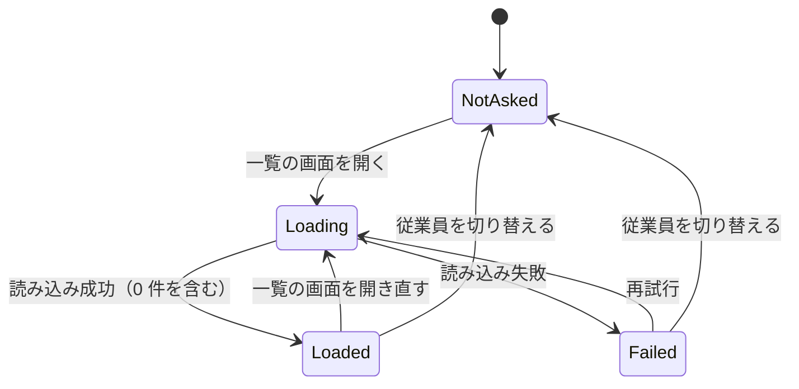
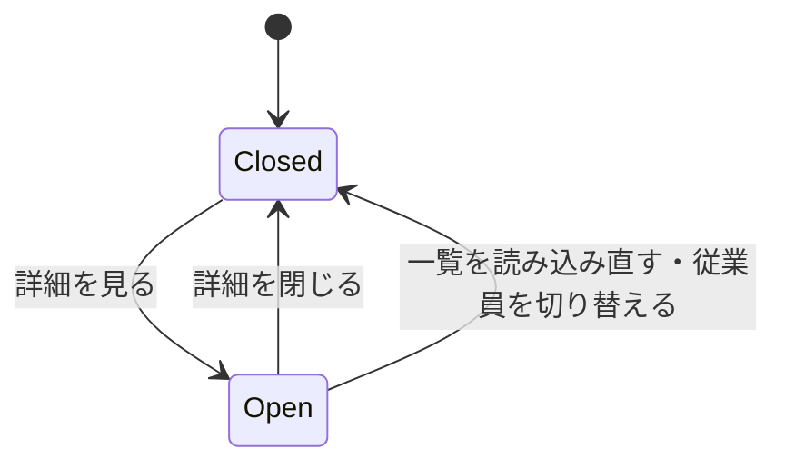
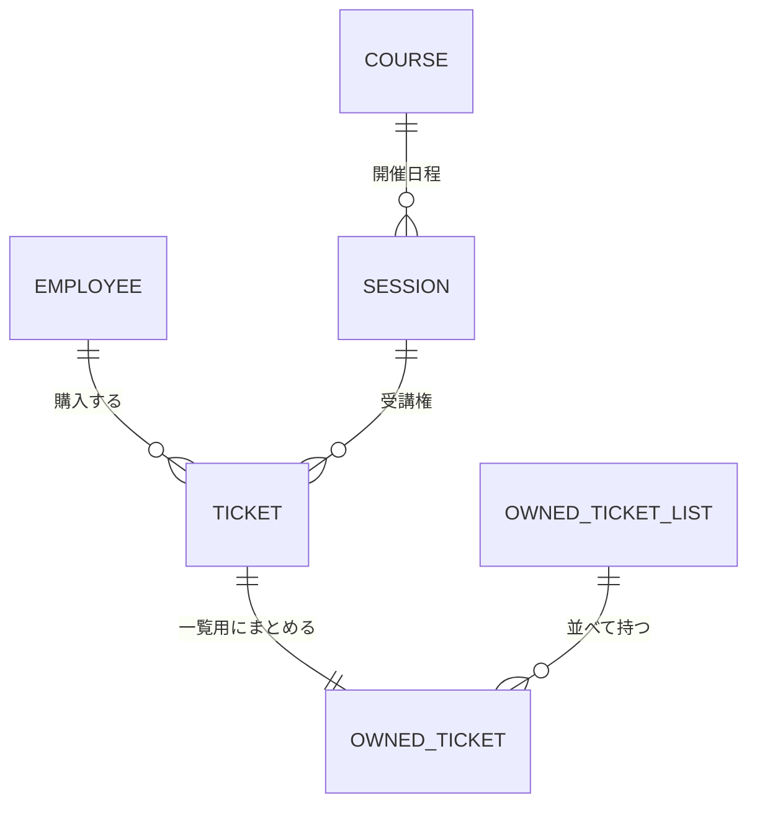

# 機能仕様（U3 購入済みチケット）

U3（`u3-my-tickets`）の振る舞いを定める。利用の流れ（手順）と状態の遷移はこのファイルが正本である。データの形は `entities.md`、判断の規則は `rules.md` が正本で、8 章の図と 9 章の表はそこから作った派生の表示である。

## 1. 範囲

| 含めるもの | ストーリーと受け入れ基準 |
| --- | --- |
| 操作中の従業員の購入済みチケットの一覧（受講済みを含む並び） | US4.2（AC4.2.1） |
| チケットがないときの案内 | AC4.2.2 |
| 一覧の中でチケットを開いて詳細を表示 | AC4.2.3 |
| 完了画面からの導線「購入済みチケットを見る」 | AC4.2.4 |
| ヘッダーからの導線「購入済みチケット」 | AC4.2.5 |

含めないもの: 購入の取り消し・返金（要件 A4）、チケットのメール送信や PDF 出力（要件 A7）、一覧の絞り込みや並べ替えの選択。

U1 で用意したチケット 1 枚の詳細（`/tickets/{チケット ID}` の画面と受け口）は変えない。U3 の一覧からは使わない（確認事項 Q2）。

## 2. 業務の部品と関数の形

業務の部品は純粋関数とし、データストアと時計は関数として外から受け取る（NFR6、プロジェクトの決まり「依存の逆転は関数の受け渡しで行う」）。

| 部品 | 関数（説明のための形） | 内容 |
| --- | --- | --- |
| Purchasing | 従業員の購入済みチケットを並べる: (全チケット, 操作中の従業員 ID, 現在時刻, 日程とコースを引く関数, 従業員を引く関数) → OwnedTicketList | BR12.1 で絞り、BR12.3 で受講済みを決め、BR12.2 で並べる |
| Purchasing | 受講済みかの判定: (開始日時, 現在時刻) → upcoming か attended | BR12.3 |
| InMemoryStore | 変更なし | U1 の「状態の読み出し」で全チケット・日程・コース・従業員を読む |
| WebApi | 購入済みチケットの一覧の受け口 | Cookie の従業員 ID を取り出し、上の関数に読み出した状態と時計を部分適用して呼ぶ |

```text
list_owned_tickets(tickets, employee_id, now, find_session, find_employee)
  = tickets
    |> filter(t -> t.employee_id == employee_id)          -- BR12.1
    |> map(t -> to_owned_ticket(t, now, ...))             -- BR12.3
    |> sort_by(BR12.2 の比較)
```

## 3. Web API の受け口（U3 で足すもの）

| 方法とパス | 内容 | 成功 | 失敗 |
| --- | --- | --- | --- |
| GET `/api/tickets` | 操作中の従業員の購入済みチケットの一覧（BR13.1・BR13.2） | 200。OwnedTicket の並び（0 件は空の並び） | U1 と同じ扱いの 5xx（内部の失敗） |

- 読み取りの要求なので、U1 の CSRF 対策（BR6.3）の対象外。
- 操作中の従業員 ID は U1 の Cookie（BR6.1・BR6.2）から取る。存在しない従業員 ID のときは空の並びを返す（BR12.1）。
- 既存の GET `/api/tickets/{チケット ID}`（U1）はそのまま。

## 4. 利用の流れ（手順）

### WF1. ヘッダーから一覧を開く（AC4.2.1、AC4.2.5）

1. 遥さんが、どの画面でもヘッダーの「購入済みチケット」を操作する（BR14.7）。
2. 画面は `/my-tickets` に移り、読み込み中の表示を出す（BR14.1・BR14.2）。
3. 画面が GET `/api/tickets` を送る。
4. Web API が Cookie の従業員について、一覧を作って返す（BR12.1〜BR12.3、BR13.1）。
5. 画面が、これからのチケットを開催日時の近い順に、そのあとに「受講済み」と示したチケットを新しい順に表示する（BR12.2、BR12.4、BR14.5）。

### WF2. チケットを開いて詳細を見る（AC4.2.3）

1. 一覧で、あるチケットの「詳細を見る」を操作する。
2. そのチケットの行の中に、完了画面と同じ 7 項目を表示する。ボタンの名前は「詳細を閉じる」に変わる（BR14.4）。通信はしない（BR13.2）。
3. もう一度操作すると閉じる。ほかのチケットの開閉には影響しない。

### WF3. 購入の完了画面から一覧を開く（AC4.2.4）

1. 購入が成功し、完了画面が表示される（U1）。
2. 「購入済みチケットを見る」を操作する（BR14.6）。
3. WF1 の 2 以降と同じ。一覧は読み込み直すので、いま購入したチケットが含まれる。

### WF4. チケットがない（AC4.2.2）

1. 購入済みのチケットがない従業員が一覧を開く。
2. Web API は空の並びを返す。
3. 画面は「購入済みのチケットはありません」と「コース一覧へ」を表示する（BR14.3）。

### WF5. 読み込めない

1. 一覧の読み込みに失敗する（通信できない、5xx）。
2. 画面は理由と「再試行」を表示する（BR14.2）。
3. 「再試行」で WF1 の 2 からやり直す。

### WF6. 一覧を表示中に従業員を切り替える

1. 一覧（開いたチケットを含む）を表示中に、ヘッダーで従業員を切り替える。
2. U1 の BR6.4 のとおりコース一覧へ戻り、一覧と開閉の状態を捨てる（BR14.8）。
3. 再び「購入済みチケット」を開くと、切り替えた後の従業員の一覧を読み込む。

## 5. 状態の遷移

### 5.1 一覧の読み込みの状態



テキストでの説明: 最初は未読み込み（NotAsked）。一覧の画面を開くと読み込み中（Loading）になり、成功すれば読み込み済み（Loaded。0 件もここ）、失敗すれば失敗（Failed）になる。失敗から「再試行」で読み込み中に戻る。読み込み済みでも画面を開き直すたびに読み込み直す。従業員を切り替えると未読み込みに戻る。

### 5.2 チケット 1 枚の開閉



テキストでの説明: 各チケットは閉じた状態（Closed）で始まり、「詳細を見る」で開き（Open）、「詳細を閉じる」で閉じる。一覧を読み込み直したときと、従業員を切り替えたときは、すべて閉じた状態に戻る。

### 5.3 チケットの受講の状態（導出）

これから（upcoming）→ 受講済み（attended）の一方向。開始日時が現在時刻以前になったとき、次に一覧を作るときから受講済みになる（BR12.3）。保存はしない。

## 6. 初期データ

追加しない。U1 の初期データで、E005 と E006 はそれぞれ 3 枚のチケットを持つ（満席の日程を作るための購入）。AC4.2.1（2 枚以上が並ぶこと）と AC4.2.2（チケットのない従業員）は、この初期データと画面からの購入で確認できる。受講済みの並びは、日程の開始日時を過ぎた状態を作れる時計を渡した単体テストで確認する。

## 7. エラーと境目の扱い

| 場面 | 扱い | ルール |
| --- | --- | --- |
| Cookie の従業員 ID が存在しない従業員を指す | 空の一覧（200） | BR12.1 |
| チケットの日程やコースが見つからない（データの不整合） | 内部の失敗として 5xx にし、ログに残す。画面は失敗と「再試行」 | BR13.1、BR14.2 |
| 開始日時が現在時刻とちょうど同じ | 受講済み | BR12.3 |
| 開催日時・購入日時・チケット番号まで同じ | 起きない（チケット番号は重複しない。U1 の FR6.2） | BR12.2 |
| 一覧の読み込み中に従業員を切り替える | 古い応答は捨て、切り替えた後の画面（コース一覧）を表示する | BR14.8 |
| 一覧の読み込み中に別の画面へ移る | 応答が来ても一覧の画面でなければ表示しない | BR14.1 |

## 8. エンティティの関係（`entities.md` から作った図）



テキストでの説明: 従業員はチケットを 0 枚以上持ち、チケットは 1 つの日程の受講権で、日程は 1 つのコースのもの（U1）。U3 は 1 枚のチケットから一覧用の OwnedTicket を作り、OwnedTicketList がそれを 0 件以上並べて持つ。

## 9. ルールの要約（`rules.md` から作った表）

| ID | 内容 |
| --- | --- |
| BR12.1 | 操作中の従業員のチケットだけ |
| BR12.2 | これから→近い順、受講済み→新しい順、同点は購入日時→チケット番号 |
| BR12.3 | 開始日時 ≤ 現在時刻で受講済み |
| BR12.4 | 行は 4 項目、開くと 7 項目 |
| BR13.1 | GET `/api/tickets` が Cookie の従業員の一覧を返す |
| BR13.2 | 応答に 7 項目まで含める |
| BR14.1 | `/my-tickets`、開くたびに読み込み直す |
| BR14.2 | 読み込み中・0 件・失敗を区別 |
| BR14.3 | 0 件の案内と「コース一覧へ」 |
| BR14.4 | その場で開閉 |
| BR14.5 | 「受講済み」を文字で |
| BR14.6 | 完了画面に「購入済みチケットを見る」 |
| BR14.7 | ヘッダーに「購入済みチケット」 |
| BR14.8 | 切り替えで前の従業員の一覧を捨てる |

## 10. 参照した資料

- `../../../inception/requirements-analysis/requirements.md`（FR6、NFR3〜NFR6、NFR10）
- `../../../inception/user-stories/stories.md`（US4.2）
- `../../../inception/units-generation/unit-of-work.md`・`unit-of-work-story-map.md`（U3）
- `../../../inception/domain-design/components.md`（Purchasing、WebApi、WebUi）
- `../../u1-purchase-skeleton/functional-design/`（BR5.9、BR5.10、BR6、BR7）
- `functional-design-questions.md`（Q1〜Q3 と前提）
