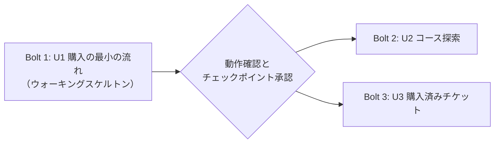

# Bolt 計画

**Bolt**（ボルト）は、1 つ以上のユニットを「機能設計 → NFR 要件 → コード生成」まで 1 回通して、実際に動くものを仕上げる作業のまとまりを指す。今回は 1 Bolt = 1 ユニットとする（`delivery-planning-questions.md` Q2）。

## 全体の流れ

テキストでの説明: Bolt 1 を最初に作り、実際に動かして確認し、承認を得る。そのあと Bolt 2 と Bolt 3 を同時に進める（別々の作業ブランチで並行して作り、それぞれ `main` にまとめる）。

| 順番 | Bolt | ユニット | ウォーキングスケルトン | 同時に進める相手 |
| --- | --- | --- | --- | --- |
| 1 | Bolt 1 | U1（u1-purchase-skeleton） | はい | なし（単独で先に完了させる） |
| 2 | Bolt 2 | U2（u2-course-search） | いいえ | Bolt 3 |
| 2 | Bolt 3 | U3（u3-my-tickets） | いいえ | Bolt 2 |

**ウォーキングスケルトン**は、端から端まで（画面 → Web API → 業務ロジック → データストア）実際に動く最小の切れ端を指す。最初の Bolt で作り、アーキテクチャ全体がつながって動くことを先に証明する。

---

## Bolt 1: 購入の最小の流れ（U1）— ウォーキングスケルトン

### 含めるユニット

- U1 `u1-purchase-skeleton`（ストーリー: US1.1、US2.1〜US2.3、US3.1〜US3.5、US4.1、US5.1）

### 証明すること（アーキテクチャのどこを確かめるか）

- MoonBit を JavaScript 向けにビルドした画面が、The Elm Architecture（TEA）で組めること（最も心配な点。`delivery-planning-questions.md` Q5）
- 画面（MoonBit）→ Web API（Rust）→ 業務ロジック → メモリ上のデータストアの経路が、2 プロセス構成（CORS あり）でつながること
- 関数の受け渡しによる依存の逆転（六角形アーキテクチャ）と、購入の「決定関数＋一括記録」が実際に動くこと

### 完了の条件（Definition of Done）

- README の手順で、Web API サーバーと画面用の静的ファイルサーバーの 2 プロセスを起動できる
- ブラウザで「コース一覧 → コース詳細と日程の選択 → 購入確認 → 購入 → e チケット表示」を最後まで操作できる
- 予算残高・残席数が購入に応じて正しく変わり、満席・受付終了・購入済み・残高不足・契約外の企業の場合は購入できずに理由が表示される
- 同時に 2 件の購入が最後の 1 席に届いても、1 件だけが成功することを自動テストで確認できる
- Rust のテスト（`cargo test`）と MoonBit のテスト（`moon test`）がすべて成功する
- U1 に割り当てたストーリーの受け入れ基準をすべて満たす

### 確かめたい仮説（Confidence hypothesis）

「MoonBit（TEA）の画面から Rust の Web API を呼び、購入の整合性（定員・予算）を保ったまま e チケットを発行できる。」 これが成り立てば、技術の組み合わせとアーキテクチャの方針は正しく、U2・U3 はこの土台に機能を足すだけで作れる。成り立たなければ、U2・U3 に進む前に画面の作り方（OQ1）を見直す。

### 見せるデモ

従業員「高橋 遥」としてコースを選び、空席のある日程を購入し、e チケットが表示されること。続けて、残高不足の従業員と、契約が終了した企業の従業員に切り替え、購入できない理由が表示されること。

### 前提（先にそろっている必要があるもの）

- MoonBit のツールが使えること。現在、この環境のネットワーク設定で取得先がブロックされている（`external-dependency-map.md` の ED-1）
- Rust のツールチェーン（導入済み。rustc / cargo 1.97.0）

---

## Bolt 2: コース探索（U2）

### 含めるユニット

- U2 `u2-course-search`（ストーリー: US1.2〜US1.9）

### 完了の条件（Definition of Done）

- キーワード・カテゴリ・空席ありのみ・期間で絞り込み、開催日順（Must）と受講料順・コース名順（Should）で並べ替えられる
- 条件の変更で全画面を読み込み直さず、結果部分だけが更新される。連続した入力では最後の条件の結果だけが表示される
- 条件が URL に反映され、URL から復元される。不正な値は無視される。詳細から一覧に戻っても条件が保たれる
- 0 件・読み込み失敗の表示と、「条件をリセット」「再試行」の操作が動く
- テストがすべて成功し、U2 に割り当てたストーリーの受け入れ基準をすべて満たす

### 確かめたい仮説

「探索条件を Web API 側で処理しても、画面の部分更新により、入力から 300 ms 以内に結果が変わる快適な探索体験を作れる。」

### 見せるデモ

「AI　入門」で検索し、カテゴリ「技術」と「空席ありのみ」で絞り込み、開催期間を指定して開催日順に並べる。その URL を新しいタブで開き、同じ結果が表示されること。

---

## Bolt 3: 購入済みチケット（U3）

### 含めるユニット

- U3 `u3-my-tickets`（ストーリー: US4.2）

### 完了の条件（Definition of Done）

- 操作中の従業員の購入済みチケットが、開催日時の近い順に一覧表示される。チケットがない場合は案内が表示される
- 一覧から選んだチケットの詳細に、完了画面と同じ項目が表示される
- 完了画面とヘッダーから購入済みチケットの一覧へ移動できる
- 従業員を切り替えると、その従業員のチケットだけが表示される
- テストがすべて成功し、U3 に割り当てたストーリーの受け入れ基準をすべて満たす

### 確かめたい仮説

「U1 で作った画面と受け口に、既存の振る舞いを変えずに機能を追加できる（ユニット間の疎結合が保たれている）。」

### 見せるデモ

2 枚購入した従業員で一覧を開き、開催日時順に並んでいること。別の従業員に切り替えると一覧が変わること。

---

## 実装の進め方（コンストラクションの設定）

- **体制**: ユニットごとに担当チームを置き、各チームが自分のユニットを独立して進め、独立して承認する（`team-allocation.md`）。
- **進め方**: ユニットごとに「機能設計 → NFR 要件 → コード生成」を順に進める（unit-major）。最初のユニット（U1）は、設計からコード生成まで通し、確認コマンド `bash scripts/verify.sh` による動作確認とチェックポイントの承認を受けてから、後続のユニットに進む。
- **同時進行**: U1 の承認後、U2 の担当チームと U3 の担当チームがそれぞれ自分のユニットを進める。チームごとに独立して進めるため、Bolt 2 と Bolt 3 は同時に進められる。
- **承認の頻度**: 各チームはユニットの最後に 1 回、設計とコードがそろってから承認を受ける。
- **確認コマンド**: `bash scripts/verify.sh`（U1 のコード生成で作成。Rust と MoonBit のテストに加え、2 プロセスを起動して「一覧 → 購入 → e チケット」を Web API 経由で通す）。完了した各ユニットのチェックポイントで使う。
- **開始の条件**: インセプションの成果をプルリクエストでレビューし、`main` にマージしてからコンストラクションに入る（利用者のご要望）。
- 作業ブランチは `main` から作り、`main` へまとめる（チームの既定のやり方: トランクベース開発、Bolt ごとにまとめて 1 コミットにする）。
