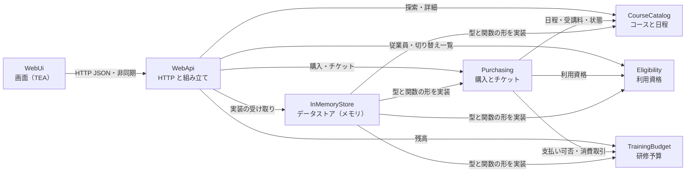

# コンポーネント設計（ドメイン設計）

研修コース e チケット購入サイトを構成する「自分たちで書くコード」の構成要素を定義する。データベースなどのインフラはコンポーネントではなく、外部依存として扱う。どの単位で配置・ビルドするか（デプロイ構成）は次の工程（ユニット生成）で決める。

前提とした決定（`domain-design-questions.md`）:

- 業務のコンポーネントは 4 つ（Q1）: コースカタログ、利用資格、研修予算、購入とチケット
- 研修予算は取引の追記だけで記録し、残高は計算で求める（Q2）
- 残席数は「定員 − 発行済みチケット数」で計算する（Q3）
- 絞り込みと並べ替えは Web API で行い、画面は全画面を読み込み直さずに結果部分だけを更新する（Q4）
- 画面は The Elm Architecture（TEA）で組み立てる（Q5）

業務の 4 コンポーネントに加え、それらを外界とつなぐアダプターとして「Web API」「データストア（メモリ実装）」「Web 画面」の 3 つを置く（六角形アーキテクチャ。ADR-001）。

## コンポーネントカタログ

```yaml
components:
  - name: CourseCatalog
    summary: 研修コースと開催日程を持ち、条件による探索と、日程ごとの購入可否の判定を行う
    behaviour: >
      コースと開催日程の参照と探索を純粋関数で提供する。探索条件はキーワード（コース名と概要が対象、空白区切りの AND、
      全角半角・大文字小文字を同一視）、カテゴリ、空席ありのみ、開催期間（両端の日を含む。終了日が開始日より前なら条件不正）、
      並べ替え（開催日が近い順・受講料の安い順・高い順・コース名順。同値はコース ID の昇順）。
      残席数は「定員 − 発行済みチケット数」で計算し、発行済みチケット数は呼び出し側から関数として受け取る
      （購入とチケットへ直接依存しないため。ADR-005）。日程の状態は「購入可」「満席」「受付終了（開催日時を過ぎた）」を判定する。
      今後の日程を持たないコースは「開催日が近い順」で最後に並べる。データを書き換える操作は持たない（初期データの読み込みのみ）。
    responsibilities:
      - コースと開催日程のデータの所有と参照
      - 探索条件の検証と、絞り込み・並べ替え
      - 日程ごとの残席数と状態（購入可・満席・受付終了）の判定
      - コース一覧に表示する集計（直近の開催日、空席のある日程の数）
    depends_on: []
    dependents:
      - component: Purchasing
        interaction: 購入対象の日程・受講料・定員・開催日時を参照し、日程の状態を判定する
      - component: WebApi
        interaction: コースの探索・詳細取得の要求を受けて呼び出す
      - component: InMemoryStore
        interaction: コースと開催日程の保存・読み出しの型と取得関数の形を実装する
    external_dependencies: []
    entities:
      - name: Course
        identifier: courseId
        attributes: [courseId, title, category, summary, description, feePoints, durationMinutes, deliveryFormat]
      - name: Session
        identifier: sessionId
        attributes: [sessionId, courseId, startsAt, endsAt, venue, capacity]

  - name: Eligibility
    summary: 契約企業と従業員を持ち、従業員が購入してよいか（利用資格）を判定する
    behaviour: >
      従業員 ID から従業員と所属企業を引き、企業の契約状態が「契約中」の場合だけ購入可能と判定する。
      存在しない従業員 ID と、契約が終了した企業の従業員は、理由を区別して「購入不可」を返す。
      閲覧（一覧・詳細の参照）は契約状態にかかわらず許可する（US5.1）。
      ローカル検証用に、切り替え可能な従業員の一覧（従業員名・企業名・契約状態）を提供する（FR1.2）。
      ログイン機能は持たず、要求に付いた従業員 ID を認証済みとして扱う（FR1.1。ADR-008）。
    responsibilities:
      - 企業と従業員のデータの所有と参照
      - 利用資格（購入してよいか）の判定と、不可の理由の区別
      - 検証用の従業員一覧の提供
    depends_on: []
    dependents:
      - component: Purchasing
        interaction: 購入前に従業員の利用資格を判定する
      - component: WebApi
        interaction: 操作中の従業員の情報と、切り替え用の従業員一覧を取得する
      - component: InMemoryStore
        interaction: 企業と従業員の保存・読み出しの型と取得関数の形を実装する
    external_dependencies: []
    entities:
      - name: Company
        identifier: companyId
        attributes: [companyId, name, contractStatus]
      - name: Employee
        identifier: employeeId
        attributes: [employeeId, displayName, companyId]
        references:
          - entity: Company
            owned_by: Eligibility
            relationship: 各従業員は 1 つの企業に所属する

  - name: TrainingBudget
    summary: 研修予算を「付与」「消費」の取引として追記だけで記録し、残高を計算する
    behaviour: >
      予算の取引は追記のみで、変更・削除をしない（ADR-002）。残高は従業員ごとの「付与の合計 − 消費の合計」で計算する。
      受講料と残高からの支払い可否（残高 ≥ 受講料。同額なら可で購入後残高 0）、不足額、購入後の残高を純粋関数で求める。
      消費の取引は購入とチケットが作る購入の決定の一部として生成され、チケットと同時に記録される（ADR-004）。
      残高が負になる取引は生成しない。
    responsibilities:
      - 予算取引（付与・消費）の所有と追記
      - 残高、不足額、購入後残高の計算
      - 消費取引の生成（購入の決定から呼ばれる）
    depends_on: []
    dependents:
      - component: Purchasing
        interaction: 購入前に残高と支払い可否を判定し、消費取引を生成する
      - component: WebApi
        interaction: 操作中の従業員の残高を取得する
      - component: InMemoryStore
        interaction: 予算取引の保存・読み出しの型と取得関数の形を実装する
    external_dependencies: []
    entities:
      - name: BudgetEntry
        identifier: entryId
        attributes: [entryId, employeeId, kind, points, occurredAt, ticketId]
        references:
          - entity: Employee
            owned_by: Eligibility
            relationship: 各予算取引は 1 人の従業員のもの
          - entity: Ticket
            owned_by: Purchasing
            relationship: 消費の取引は、それを生んだ 1 枚のチケットを指す（付与の取引は指さない）

  - name: Purchasing
    summary: 購入の可否を検証し、e チケットと予算の消費取引を 1 つの決定として生成する。購入済みチケットを提供する
    behaviour: >
      購入は「現在のデータの写し（日程、受講料、発行済み数、残高、その従業員の購入済み日程、利用資格、現在時刻）」を受け取り、
      「購入の決定（チケット 1 枚＋消費取引 1 件）」か「拒否の理由」を返す純粋関数として表す（ADR-004）。
      検証する条件と拒否の理由は、利用資格なし（契約外の企業・存在しない従業員）、日程が存在しない、受付終了、満席、購入済み、残高不足。
      いずれかに当たれば何も生成しない。受講料はコースのデータから決め、要求に含まれる金額は使わない（FR5.5）。
      1 回の購入で 1 名・1 日程につき 1 枚。チケット番号はほかと重複しない番号を発行する。
      決定の記録はデータストアの「検証と記録をまとめて 1 回で行う」関数に任せ、同時に届いた購入でも定員を超えない（FR5.8）。
      購入済みチケットの一覧（開催日時の近い順）と、チケット 1 枚の詳細を提供する。
    responsibilities:
      - チケットの所有
      - 購入可否の検証と拒否理由の決定
      - チケットと消費取引の生成（購入の決定）
      - 購入済みチケットの一覧と詳細
      - 日程ごとの発行済みチケット数の提供
    depends_on:
      - component: CourseCatalog
        interaction: 購入対象の日程・受講料・定員・開催日時を参照し、日程の状態を判定する
        style: sync
      - component: Eligibility
        interaction: 従業員の利用資格を判定する
        style: sync
      - component: TrainingBudget
        interaction: 残高と支払い可否を判定し、消費取引を生成する
        style: sync
    dependents:
      - component: WebApi
        interaction: 購入、購入済みチケットの一覧・詳細の要求を受けて呼び出す
      - component: InMemoryStore
        interaction: チケットの保存・読み出しの型と、購入の決定をまとめて記録する関数の形を実装する
    external_dependencies: []
    entities:
      - name: Ticket
        identifier: ticketId
        attributes: [ticketId, ticketNumber, employeeId, sessionId, paidPoints, purchasedAt]
        references:
          - entity: Employee
            owned_by: Eligibility
            relationship: 各チケットは 1 人の従業員が購入したもの
          - entity: Session
            owned_by: CourseCatalog
            relationship: 各チケットは 1 つの開催日程の受講権

  - name: InMemoryStore
    summary: 各業務コンポーネントが求めるデータの読み書きを、メモリ上のデータで実装する（将来 PostgreSQL の実装に差し替える）
    behaviour: >
      業務コンポーネントが定める「取得関数」「記録関数」の形を、メモリ上の不変なデータで実装する（ADR-001、NFR7）。
      状態の更新は「現在の状態 → 新しい状態」を返す関数を 1 か所で直列に適用し、購入の決定の記録では、
      記録の直前に最新の状態で購入の検証をやり直してから、チケットと消費取引を同時に反映する（ADR-004）。
      起動時に初期データ（企業・従業員・予算の付与・コース・開催日程）を生成し、開催日程は起動日を基準にした未来の日時と、
      受付終了の確認用の過去の日時を含める（FR7）。再起動すると初期データに戻る。
    responsibilities:
      - 業務コンポーネントの読み書き関数のメモリ実装
      - 状態更新の直列化と、購入の決定の一括記録
      - 初期データの生成
    depends_on:
      - component: CourseCatalog
        interaction: コースと開催日程の型と取得関数の形を実装する
        style: sync
      - component: Eligibility
        interaction: 企業と従業員の型と取得関数の形を実装する
        style: sync
      - component: TrainingBudget
        interaction: 予算取引の型と取得関数の形を実装する
        style: sync
      - component: Purchasing
        interaction: チケットの型と、購入の決定を検証し直して記録する関数の形を実装する
        style: sync
    dependents:
      - component: WebApi
        interaction: 起動時に各業務コンポーネントへ渡す読み書き関数を受け取る
    external_dependencies:
      - name: PostgreSQL（将来）
        kind: database
        purpose: 本来のデータ保存先。今回は接続せず、同じ関数の形の別実装に差し替えられることだけを保証する
    entities: []

  - name: WebApi
    summary: HTTP で画面からの要求を受け、業務コンポーネントを組み合わせて JSON を返す。起動時に各部品を組み立てる
    behaviour: >
      HTTP の要求を検証（ID の形式、探索条件の値、必須項目）し、不正な要求には 4xx と理由を返す（NFR3）。
      要求に付いた操作中の従業員 ID を読み取り、利用資格の判定に渡す（ADR-008）。
      探索の要求では、データストアから得た発行済み数の取得関数をコースカタログの探索関数に渡す（ADR-005）。
      購入の要求では、受講料などの金額を要求から受け取らない。要求ごとにメソッド・パス・状態コード・処理時間をログに出し、
      購入の拒否は理由をログに残す（NFR10）。起動時に、データストアの関数を各業務コンポーネントの関数に部分適用して組み立てる。
    responsibilities:
      - HTTP の受け口（コース探索・詳細、購入、チケット一覧・詳細、操作中の従業員と残高、切り替え用の従業員一覧）
      - 要求の検証と、業務の結果・拒否理由から HTTP 応答への変換
      - 部品の組み立て（どの実装を使うかの決定）
      - 要求のログ
    depends_on:
      - component: CourseCatalog
        interaction: コースの探索・詳細取得を呼び出す
        style: sync
      - component: Eligibility
        interaction: 操作中の従業員の情報と、切り替え用の従業員一覧を取得する
        style: sync
      - component: TrainingBudget
        interaction: 操作中の従業員の残高を取得する
        style: sync
      - component: Purchasing
        interaction: 購入、購入済みチケットの一覧・詳細を呼び出す
        style: sync
      - component: InMemoryStore
        interaction: 起動時に読み書き関数の実装を受け取り、業務コンポーネントに渡す
        style: sync
    dependents:
      - component: WebUi
        interaction: 画面からの HTTP 要求（JSON）を受ける
    external_dependencies: []
    entities: []

  - name: WebUi
    summary: 従業員が操作する画面。全画面を読み込み直さずに、API を非同期で呼んで必要な部分だけを更新する
    behaviour: >
      The Elm Architecture（TEA）で組み立てる。画面全体の状態を 1 つの不変なデータで持ち、
      「メッセージ＋状態 → 新しい状態＋コマンド」を返す更新関数と、「状態 → 画面」を返す描画関数はどちらも純粋関数とする（ADR-007）。
      API 呼び出し・URL の書き換え・時刻の取得はコマンドとして外に出す。
      探索条件の変更では全画面を読み込み直さず、API を非同期で呼んで結果部分だけを更新する（ADR-006）。
      入力中の連続した変更では、最後の要求の結果だけを反映し、古い応答で上書きしない。
      探索条件は URL に反映し、URL から復元する。URL の不正な値は無視する（US1.8）。
      読み込み中・0 件・読み込み失敗を別々の表示にする（US1.9）。購入の確定中は確定ボタンを無効にする（US3.4）。
      状態（満席・受付終了・購入済み）は色だけでなく文字で示し、主要な流れをキーボードで操作できるようにする（NFR5）。
      ヘッダーに操作中の従業員名と予算残高を常に表示し、検証用の従業員切り替えを提供する（FR1.2、US3.1）。
    responsibilities:
      - 画面の状態の保持と、メッセージによる状態遷移
      - 画面の描画（コース一覧と探索、コース詳細と日程選択、購入確認、完了と e チケット、購入済みチケット一覧、従業員切り替え）
      - API 呼び出しと URL の同期（コマンドとして実行）
      - 入力の即時チェック（期間の前後関係など）と、エラー・空状態の表示
    depends_on:
      - component: WebApi
        interaction: コース・日程・残高・チケットの取得と購入を HTTP（JSON）で行う
        style: sync
    dependents: []
    external_dependencies:
      - name: Web ブラウザ
        kind: other
        purpose: 画面を動かす実行環境（JavaScript）
    entities: []
```

## コンポーネント図



テキストでの説明: WebUi は WebApi だけを呼ぶ。WebApi は 4 つの業務コンポーネントとデータストアを呼び、起動時に組み立てる。Purchasing は CourseCatalog・Eligibility・TrainingBudget を参照する。InMemoryStore は 4 つの業務コンポーネントが定める型と関数の形を実装する。業務コンポーネントはデータストアにも WebApi にも依存しない。依存に循環はない。

## コンポーネント一覧

| Component | Purpose | Depends On | Dependents | Entities Owned |
| --- | --- | --- | --- | --- |
| CourseCatalog | コースと開催日程の参照・探索、日程の状態判定 | なし | Purchasing, WebApi, InMemoryStore | Course, Session |
| Eligibility | 企業・従業員の参照と利用資格の判定 | なし | Purchasing, WebApi, InMemoryStore | Company, Employee |
| TrainingBudget | 予算取引の追記と残高の計算 | なし | Purchasing, WebApi, InMemoryStore | BudgetEntry |
| Purchasing | 購入の検証と決定、チケットの提供 | CourseCatalog, Eligibility, TrainingBudget | WebApi, InMemoryStore | Ticket |
| InMemoryStore | 読み書き関数のメモリ実装、直列化、初期データ | CourseCatalog, Eligibility, TrainingBudget, Purchasing | WebApi | なし |
| WebApi | HTTP の受け口、検証、組み立て、ログ | CourseCatalog, Eligibility, TrainingBudget, Purchasing, InMemoryStore | WebUi | なし |
| WebUi | 画面（TEA）、非同期更新、URL 同期 | WebApi | なし | なし |

## エンティティの所有

| Entity | Owning Component | Identifier | Attributes | References |
| --- | --- | --- | --- | --- |
| Course | CourseCatalog | courseId | courseId, title, category, summary, description, feePoints, durationMinutes, deliveryFormat | なし |
| Session | CourseCatalog | sessionId | sessionId, courseId, startsAt, endsAt, venue, capacity | Course（同じコンポーネント内。各日程は 1 つのコースに属する） |
| Company | Eligibility | companyId | companyId, name, contractStatus | なし |
| Employee | Eligibility | employeeId | employeeId, displayName, companyId | Company（Eligibility） |
| BudgetEntry | TrainingBudget | entryId | entryId, employeeId, kind, points, occurredAt, ticketId | Employee（Eligibility）、Ticket（Purchasing） |
| Ticket | Purchasing | ticketId | ticketId, ticketNumber, employeeId, sessionId, paidPoints, purchasedAt | Employee（Eligibility）、Session（CourseCatalog） |

残席数・残高・日程の状態はエンティティとして保存せず、上の記録から計算する（ADR-002、ADR-003）。

## 外部依存

| Component | Dependency | Kind | Purpose |
| --- | --- | --- | --- |
| InMemoryStore | PostgreSQL（将来） | database | 本来の保存先。今回は接続しない。同じ関数の形の別実装に差し替える |
| WebUi | Web ブラウザ | other | 画面の実行環境 |

## 分けた理由（Rationale）

| Component | 独立したコンポーネントにした理由 |
| --- | --- |
| CourseCatalog | 研修の品ぞろえ（コース・日程）は、購入や予算とは別の理由・頻度で変わる。探索のロジックが最も多く、UX の重点（探しやすさ）が集中する |
| Eligibility | 契約企業と従業員は、将来は社内ポータルなど外部の認証・人事の仕組みに置き換わる可能性が高い。境界を分けておけば差し替えやすい |
| TrainingBudget | 予算の付与・消費は会計に近いルール（追記のみ、残高は計算）を持ち、変更理由が購入と異なる |
| Purchasing | 購入は唯一、複数のデータ（チケットと予算）を同時に変える処理で、検証ルールと整合性の要がここに集まる |
| InMemoryStore | データの保存方法（メモリ／PostgreSQL）を業務ロジックから切り離し、差し替えられるようにするため（NFR7） |
| WebApi | HTTP という外界の都合（形式の変換、状態コード、ログ）を業務ロジックから切り離すため |
| WebUi | 実行環境（ブラウザ）と言語（MoonBit）が異なり、変更理由も画面の体験に限られるため |

### 採らなかった分け方（Alternatives Rejected）

- **3 つに分ける（アカウントに企業・従業員・予算をまとめる）**: 利用資格（将来は外部の仕組みに置き換わる）と予算（会計的なルール）は変更理由が異なるため、まとめると片方の変更がもう片方に波及する。
- **2 つに分ける（購入に利用資格・予算・チケットをまとめる）**: 購入コンポーネントが大きくなりすぎ、予算の計算や利用資格の判定を単独でテストしにくい。
- **CourseCatalog が Purchasing に直接依存して発行済み数を取得する**: Purchasing も CourseCatalog に依存するため循環になる。発行済み数は関数として受け取る形にした（ADR-005）。
