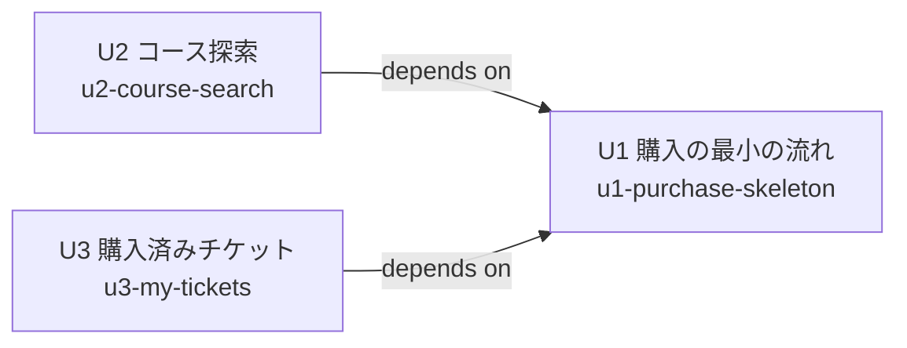

# ユニット間の依存関係

この文書は、どのユニットがどのユニットに依存するか（構造）だけを示す。作る順番や優先度は、次の工程（デリバリー計画）で決める。

## 依存関係（DAG）



テキストでの説明: U2 は U1 に依存する。U3 は U1 に依存する。U2 と U3 の間に依存はない。循環はない。

| ユニット | 依存先 | 依存する理由 |
| --- | --- | --- |
| U1 購入の最小の流れ | なし | monorepo の土台、TEA の実行の土台、データストア、コース一覧の受け口と画面を自ら作る |
| U2 コース探索 | U1 | U1 のコース一覧の受け口・画面・コースカタログに探索条件を加えるため |
| U3 購入済みチケット | U1 | U1 のチケット・チケット詳細の受け口・e チケットの表示部品を使うため |

```yaml
units:
  - name: u1-purchase-skeleton
    depends_on: []
  - name: u2-course-search
    depends_on: [u1-purchase-skeleton]
  - name: u3-my-tickets
    depends_on: [u1-purchase-skeleton]
```

## ユニット間の接点

すべてのユニットは同じ Rust の実行ファイルと同じ MoonBit の画面の中に機能を足すため、接点はプロセス間の通信ではなく、コード上の共有部分である。

| 接点 | 提供するユニット | 使うユニット | 内容 |
| --- | --- | --- | --- |
| コースカタログの型と一覧の関数 | U1 | U2 | U2 は一覧の関数に探索条件を加える。U1 は条件を後から足せる形で用意する |
| コース一覧の Web API の受け口 | U1 | U2 | U2 は同じ受け口に探索条件のクエリを追加する |
| 画面の状態（TEA の Model）とメッセージ | U1 | U2, U3 | U2・U3 は状態とメッセージに自分の分を追加する |
| チケットの型とデータストアのチケット | U1 | U3 | U3 は従業員ごとの一覧の関数を追加する |
| e チケットの表示部品 | U1 | U3 | U3 は一覧からの詳細表示に同じ部品を使う |
| 操作中の従業員 ID の受け渡し | U1 | U2, U3 | U2・U3 の受け口も同じ方法で従業員を識別する |

## 並行して開発できる組み合わせ

- U2 と U3 は互いに依存しないため、U1 の完了後は並行して作れる。
- 有効な順番は「U1 → U2 → U3」と「U1 → U3 → U2」のどちらでもよい（どちらを選ぶかはデリバリー計画で決める）。

## ウォーキングスケルトン

- DAG の最初のユニットは **U1（u1-purchase-skeleton）** で、端から端まで動く最小の切れ端とする（今回の進め方では最初のユニットをそうする決まり。`units-generation-questions.md` Q2）。
- U1 は U2・U3 がなくても単独で動く。探索なしのコース一覧から購入して e チケットを表示するまで、画面・Web API・業務ロジック・データストアのすべてを通る。
- 実際に動いていることの確認方法（確認用コマンド）は、コンストラクションの開始時に決める。
